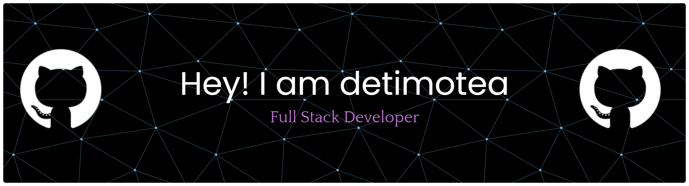
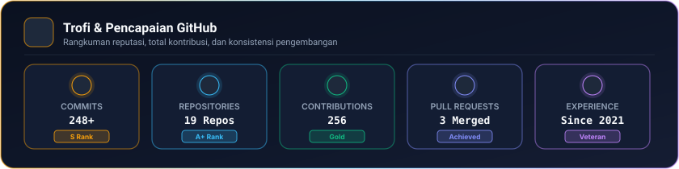
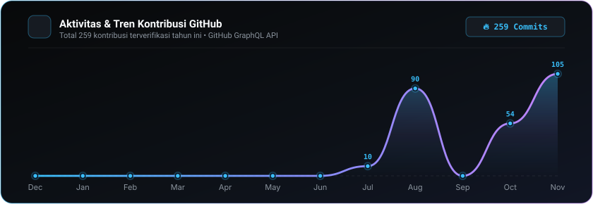

 

  

---

## 🧑‍💻 Tentang Saya
https://davidtimoteus.github.io/Portofolioku/
<table>
<tr>
<td width="62%" valign="top">

- 🔭 **Sedang Membangun**: **[MyDuit](https://github.com/DavidTimoteus)** — Aplikasi pencatat keuangan pribadi cerdas berbasis **Google Apps Script + Tailwind CSS + Gemini AI**
- 🌱 **Fokus Pembelajaran**: Memperdalam arsitektur modern **Laravel 11**, **TypeScript**, dan ekosistem backend **Node.js**
- 👨‍💻 **Pengalaman Proyek**: Pernah merancang & membangun **LMS**, **klickcare**, serta **route_wise** (integrasi *Flutter × Odoo ERP*)
- 💬 **Diskusi**: Arsitektur RESTful API, Database Design, dan integrasi Artificial Intelligence pada aplikasi nyata
- ⚡ **Prinsip**: *Clean Code, Scalable System, dan mengubah ide rumit menjadi aplikasi yang nyaman digunakan orang banyak*

</td>
<td width="38%" valign="top" align="center">

</td>
</tr>
</table>

- 📫 **Kontak Cepat**: Hubungi saya lewat bagian [Terhubung Dengan Saya](#-terhubung-dengan-saya) di bawah.

---

## 🛠️ Tech Stack & Ekosistem

---

## 🎯 Progres & Roadmap Pengembangan Saat Ini

---

## 💡 Progress Keahlian (Realtime, dihitung dari semua repo)

<!--LANG-STATS-START-->

  

  

    
<b>📊 Klik di sini untuk melihat tabel rincian data</b>

| Bahasa / Teknologi | Indikator Progress | Persentase |
|---|:---:|:---:|
| **JavaScript** |  | `31%` |
| **HTML** |  | `20%` |
| **Blade** |  | `13%` |
| **CSS** |  | `12%` |
| **PHP** |  | `10%` |
| **Dart** |  | `7%` |
| **Python** |  | `4%` |
| **TypeScript** |  | `2%` |

*Terakhir diperbarui otomatis: 2026-11-11 — dihitung dari seluruh repository publik.*

  

<!--LANG-STATS-END-->

---

## 🏆 Trofi & Pencapaian GitHub

---

## 📈 Aktivitas & Tren Kontribusi

---

## 📊 Statistik & Streak GitHub

 

---

## 🐍 Ular Pemakan Kontribusi

<picture>
  <source media="(prefers-color-scheme: dark)" srcset="https://raw.githubusercontent.com/DavidTimoteus/DavidTimoteus/output/github-contribution-grid-snake-dark.svg" />
  <source media="(prefers-color-scheme: light)" srcset="https://raw.githubusercontent.com/DavidTimoteus/DavidTimoteus/output/github-contribution-grid-snake.svg" />
  
</picture>

---

## 🤝 Terhubung Dengan Saya

  

<table align="center" style="border: none; background: transparent;">
  <tr align="center">
    <td width="25%" align="center">
      <a href="https://linkedin.com/in/DavidTimoteus" target="_blank">
        
         
        <b>LinkedIn</b>
         
        /in/DavidTimoteus
      </a>
    </td>
    <td width="25%" align="center">
      <a href="mailto:kconkdeveloper@gmail.com">
        
         
        <b>Email</b>
         
        kconkdeveloper@gmail.com
      </a>
    </td>
    <td width="25%" align="center">
      <a href="https://instagram.com/DavidTimoteus" target="_blank">
        
         
        <b>Instagram</b>
         
        @DavidTimoteus
      </a>
    </td>
    <td width="25%" align="center">
      <a href="https://github.com/DavidTimoteus">
        
         
        <b>GitHub</b>
         
        @DavidTimoteus
      </a>
    </td>
  </tr>
</table>

 

